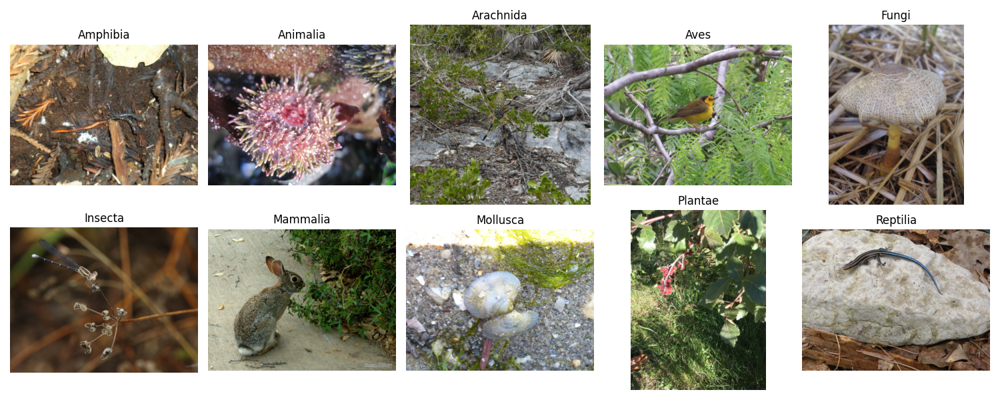
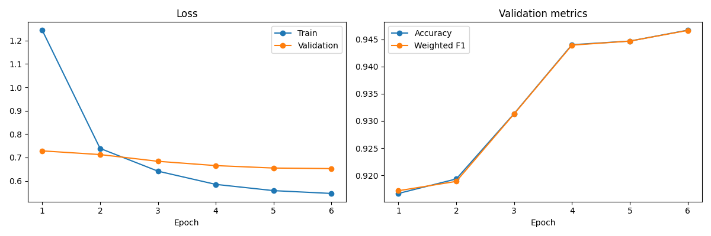
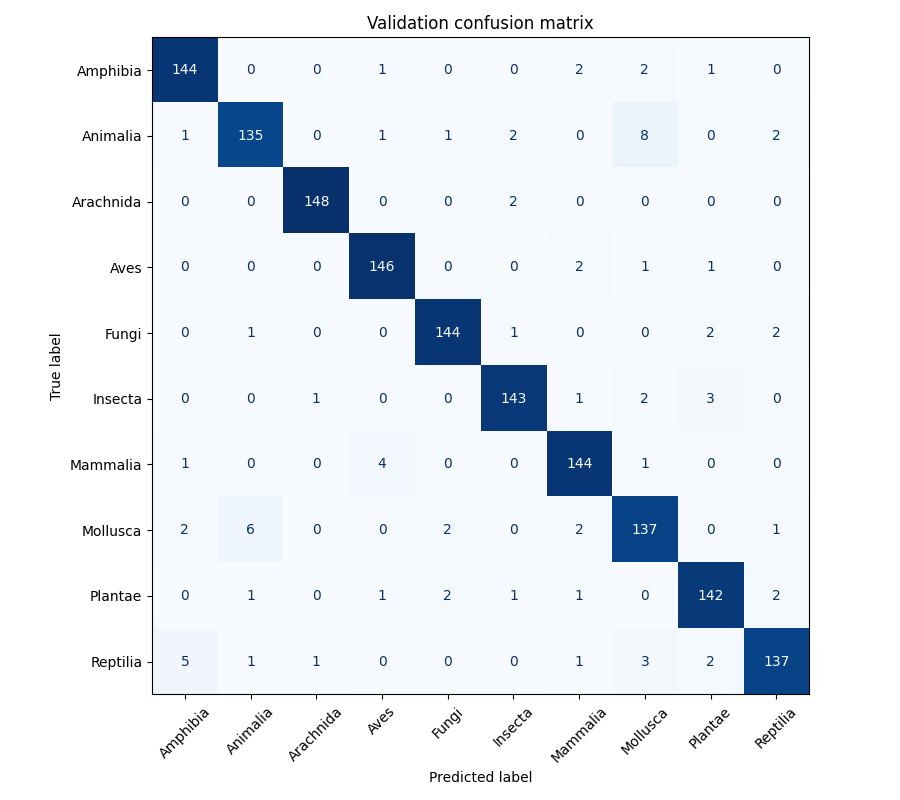

# Image Classification: 10 Groups of Animals, Plants and Fungi

Classifying nature photos into **10 taxonomic groups** by fine-tuning pretrained **ConvNeXt** models with PyTorch.

**Kaggle score (weighted F1):** 0.9321 private / 0.9566 public (ConvNeXt-Small)

## Data
- 9,999 training images (about 1,000 per class) and 2,000 test images
- Classes: Amphibia, Animalia, Arachnida, Aves, Fungi, Insecta, Mammalia, Mollusca, Plantae, Reptilia

The data belongs to the course competition and is not included in this repo.

## Approach
1. **Stratified 85/15 split** (8,499 train / 1,500 validation).
2. **Augmentation:** random resized crops, flips, small rotations and colour jitter; ImageNet normalisation.
3. **Transfer learning:** ImageNet-pretrained ConvNeXt with a new 10-class head; the backbone gets a lower learning rate than the head.
4. **Training:** mixed precision, label smoothing, cosine learning-rate schedule; the checkpoint with the best validation weighted F1 is kept.
5. **Test-time augmentation:** each test image is predicted as is and flipped, and the probabilities are averaged.

## Two runs

| Notebook | Model | Image size | Epochs | Validation F1 | Kaggle private / public |
|---|---|---|---|---|---|
| `image_classification_baseline.ipynb` | ConvNeXt-Tiny (28M) | 224 | 10 | 0.919 | 0.9128 / 0.9400 |
| `image_classification.ipynb` | ConvNeXt-Small (50M) | 320 | 6 | 0.947 | 0.9321 / 0.9566 |

The baseline peaked at epoch 3 and then plateaued. The second run changed the model size and the image size together, so their separate effects are not measured. The second run also uses **livelossplot** to draw loss, accuracy and F1 live during training.

Baseline charts: [training curves](images/baseline_training_curves.png), [confusion matrix](images/baseline_confusion_matrix.png).

## Limitations and next steps
- Mollusca is the weakest class (F1 0.90 on validation).
- The final model is trained on 85% of the data; retraining on all of it, MixUp/CutMix, or an ablation separating model size from image size are natural next steps.

## How to run
Open either notebook in `notebooks/` on Kaggle with the competition data attached and a GPU accelerator, then **Run All**.
