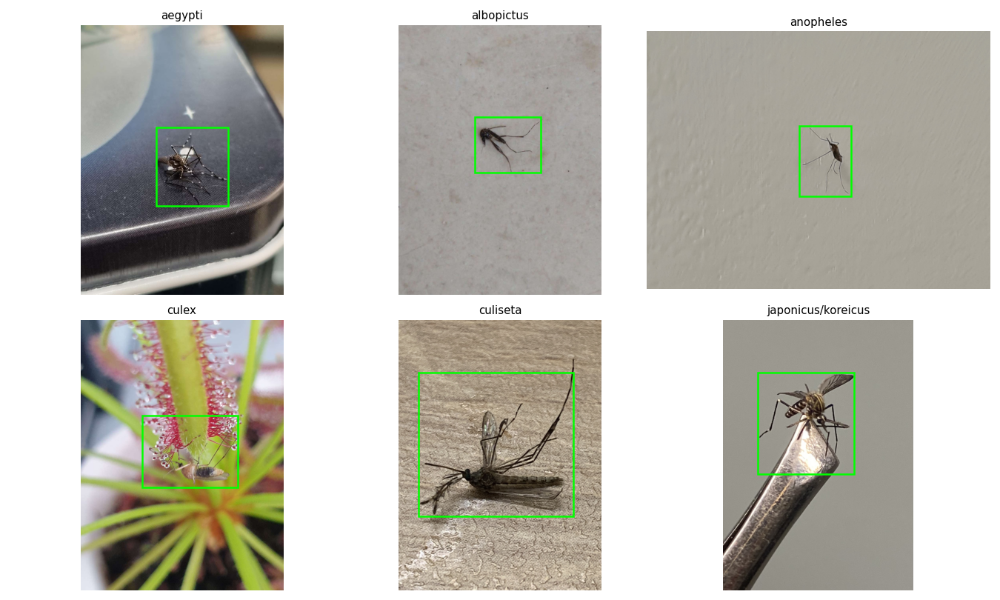
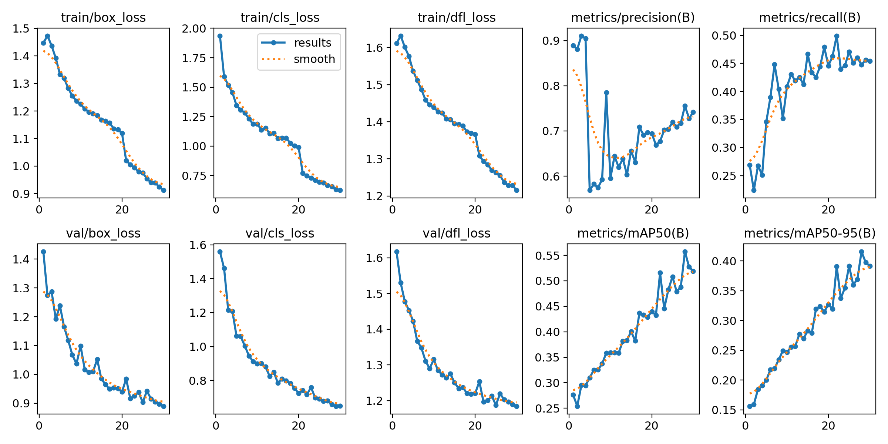
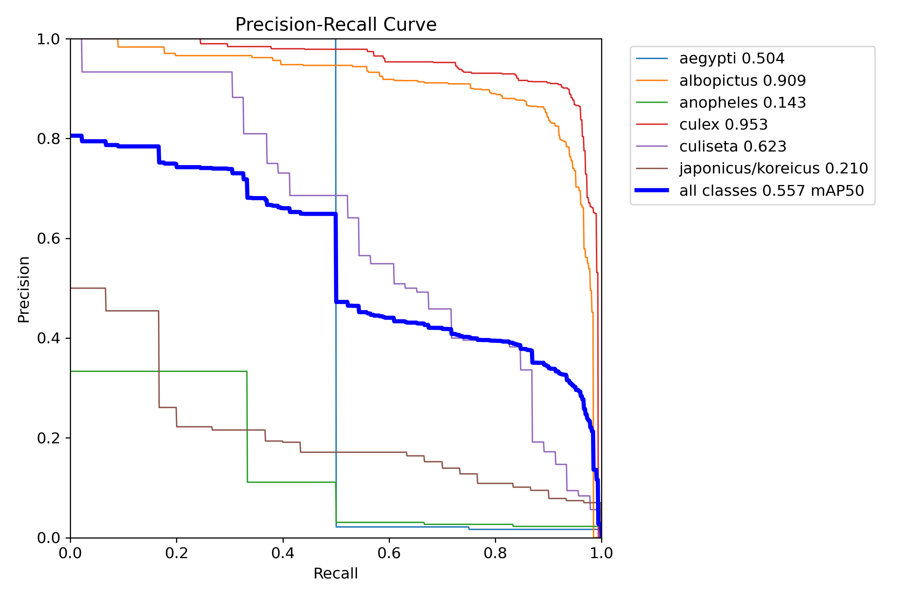
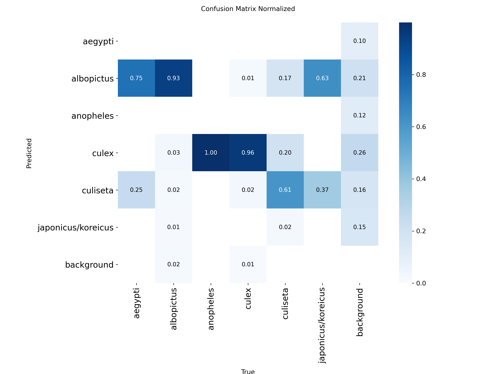
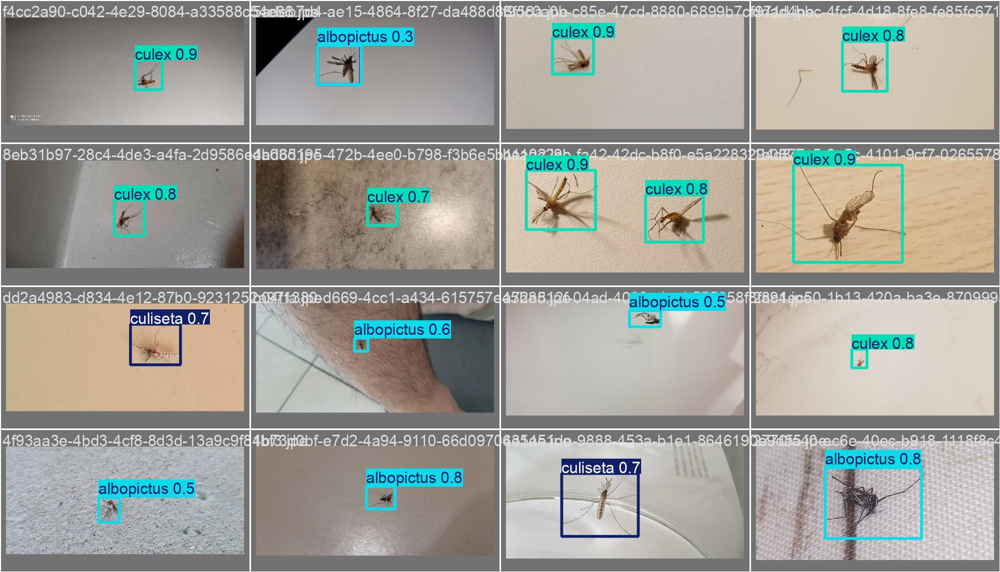

# Mosquito Detection and Species Classification (YOLOv8)

Detecting mosquitoes in citizen-science phone photos, many taken in poor light, and classifying each one into one of **6 species groups** with a fine-tuned **YOLOv8m**.

**Kaggle score (mAP):** 0.83152 private / 0.82802 public (late submission)

## Data
- 7,500 training images and 525 test images, one mosquito per image, boxes in YOLO format
- Classes: aegypti, albopictus, anopheles, culex, culiseta, japonicus/koreicus
- Heavily imbalanced: about 3,300 images each of culex and albopictus, but only 35 aegypti and 59 anopheles

The data belongs to the course competition and is not included in this repo.

## Approach
1. **Stratified 90/10 split** by species (6,750 train / 750 validation), so rare classes appear in both sets.
2. **YOLOv8m** pretrained on COCO, fine-tuned for 30 epochs at 640 px on a Tesla T4 (about 1.7 hours).
3. **Augmentation for low light:** stronger brightness variation (`hsv_v=0.6`, default 0.4), plus small rotations and occasional vertical flips.
4. **Submission:** the notebook reads `sample_submission.csv` and matches its format automatically (one row per image, class names, normalised box coordinates). A low confidence threshold (0.01) makes sure almost every test image gets a box.

## Results

**Validation (750 images, best checkpoint):** mAP@0.5 = 0.543, mAP@0.5:0.95 = 0.405

| Class | Validation images | mAP@0.5 | mAP@0.5:0.95 |
|---|---|---|---|
| culex | 331 | 0.952 | 0.719 |
| albopictus | 333 | 0.910 | 0.687 |
| culiseta | 46 | 0.625 | 0.496 |
| aegypti | 4 | 0.421 | 0.309 |
| japonicus/koreicus | 30 | 0.211 | 0.166 |
| anopheles | 6 | 0.142 | 0.055 |

## What the results show
- The model finds and classifies the two common species very well (mAP@0.5 above 0.9).
- **Class imbalance is the main weakness.** Rare species are mostly predicted as a common look-alike: aegypti and japonicus/koreicus as albopictus, anopheles as culex.
- The validation mAP averages all 6 classes equally, so classes with only 4 or 6 validation images pull it down sharply. This likely explains much of the gap to the higher Kaggle score, where the test set is mostly culex and albopictus, but the exact Kaggle scoring is not known.
- The validation mAP trend was still upward near epoch 30, so longer training would probably help.

## Limitations and next steps
- Very few examples of rare classes; their per-class scores rest on 4–30 validation images and are noisy.
- Ideas: oversampling or class-weighted loss for rare species, a larger input size (e.g. 1024) for small insects, a larger model (YOLOv8l), more epochs, and low-light enhancement (e.g. CLAHE) on both training and test images.

## How to run
Open `notebook/mosquito_detection_yolov8.ipynb` on Kaggle with the competition data attached and a GPU accelerator, then **Run All**. Requires `ultralytics` (installed in the first cell).
